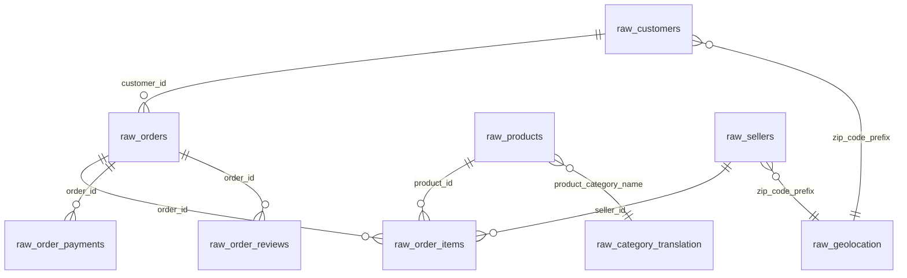

# 03 — Data Dictionary

> Source: *Brazilian E-Commerce Public Dataset by Olist* (Kaggle, CC BY-NC-SA 4.0).
> 9 CSVs, ~100k orders, 2016-09-04 → 2018-10-17. Nothing here is redistributed in this repo.

## 1. Tables at a glance

| Table (raw name) | Rows (approx.) | Grain — one row per… | Primary key |
|---|---|---|---|
| `raw_orders` | 99,441 | order | `order_id` |
| `raw_customers` | 99,441 | order-customer link | `customer_id` |
| `raw_order_items` | 112,650 | item within an order | `(order_id, order_item_id)` |
| `raw_order_payments` | 103,886 | payment entry within an order | `(order_id, payment_sequential)` |
| `raw_order_reviews` | 99,224 | review | `review_id` (not unique — see §4) |
| `raw_products` | 32,951 | product | `product_id` |
| `raw_sellers` | 3,095 | seller | `seller_id` |
| `raw_geolocation` | 1,000,163 | zip-prefix observation | none (duplicates by design) |
| `raw_category_translation` | 71 | category name mapping | `product_category_name` |

Row counts are approximate and version-dependent — `sql/03_data_quality_checks.sql` prints the real
counts from your copy. Never quote a row count you did not compute.

## 2. Column detail

### `raw_orders` — the spine of the model
| Column | Type | Notes |
|---|---|---|
| `order_id` | VARCHAR(32) | PK. Joins to items, payments, reviews |
| `customer_id` | VARCHAR(32) | FK → `raw_customers.customer_id`. **Per order, not per person** |
| `order_status` | VARCHAR(20) | `delivered`, `shipped`, `canceled`, `unavailable`, `invoiced`, `processing`, `created`, `approved` |
| `order_purchase_timestamp` | DATETIME | Start of the clock. Use this for revenue attribution |
| `order_approved_at` | DATETIME | Nullable (payment not approved) |
| `order_delivered_carrier_date` | DATETIME | Handover to carrier |
| `order_delivered_customer_date` | DATETIME | Null unless delivered |
| `order_estimated_delivery_date` | DATETIME | The promise shown to the customer |

### `raw_customers`
| Column | Notes |
|---|---|
| `customer_id` | One per order — this is the trap |
| `customer_unique_id` | The actual person. **Use this for retention/RFM** |
| `customer_zip_code_prefix` | First 5 digits, joins to geolocation |
| `customer_city`, `customer_state` | Free text, needs normalising |

### `raw_order_items`
| Column | Notes |
|---|---|
| `order_id`, `order_item_id` | Composite key; `order_item_id` is 1..n within the order |
| `product_id`, `seller_id` | FKs |
| `shipping_limit_date` | Seller's deadline to hand over — a *seller* SLA, not a customer promise |
| `price` | Item price (BRL) |
| `freight_value` | Freight charged for this item |

### `raw_order_payments`
| Column | Notes |
|---|---|
| `payment_sequential` | 1..n when an order is paid with multiple instruments |
| `payment_type` | `credit_card`, `boleto`, `voucher`, `debit_card`, `not_defined` |
| `payment_installments` | Number of instalments (Brazilian credit culture — 1–24) |
| `payment_value` | Amount on this payment entry |

### `raw_order_reviews`
| Column | Notes |
|---|---|
| `review_id` | **Not unique.** ~99.2k rows for ~98.7k distinct ids |
| `order_id` | A review belongs to an order |
| `review_score` | 1–5 |
| `review_comment_title`, `review_comment_message` | Null for the majority — do not treat as a survey sample |
| `review_creation_date`, `review_answer_timestamp` | Use the answer timestamp to pick the latest review |

### `raw_products`
`product_id`, `product_category_name` (nullable for a few hundred rows),
`product_name_lenght`, `product_description_lenght` (yes, the columns are misspelled upstream —
keep the upstream spelling in `raw_*` and fix it in the view layer),
`product_photos_qty`, `product_weight_g`, `product_length_cm`, `product_height_cm`, `product_width_cm`.

### `raw_sellers`
`seller_id`, `seller_zip_code_prefix`, `seller_city`, `seller_state`.

### `raw_geolocation`
`geolocation_zip_code_prefix`, `geolocation_lat`, `geolocation_lng`, `geolocation_city`,
`geolocation_state`. ~1M rows, many per zip prefix — aggregate to one centroid per prefix before
joining, otherwise your order count explodes.

### `raw_category_translation`
`product_category_name` (Portuguese) → `product_category_name_english`. Only 71 rows while products
reference ~73 categories → **always `LEFT JOIN`**, or you silently drop products.

## 3. Relationships (ERD)

## 4. Traps in this dataset (each one has cost someone an interview)

| # | Trap | Symptom | Correct handling |
|---|---|---|---|
| 1 | `customer_id` is per order | Repeat rate ≈ 0% (every "customer" has one order) | Aggregate on `customer_unique_id` |
| 2 | `review_id` duplicated | Inflated review counts, double-counted scores | Dedupe on `review_answer_timestamp` |
| 3 | Geolocation has many rows per zip | Join multiplies orders | `AVG(lat), AVG(lng)` per prefix, then join |
| 4 | Category translation missing 2 categories | Product rows vanish on `INNER JOIN` | `LEFT JOIN` + `COALESCE(..., 'unknown')` |
| 5 | 2016 has almost no orders | Trend line dives at the start | Filter `>= 2017-01-01` and say so |
| 6 | Last month (2018-09/10) is partial | Final point always looks like a collapse | Flag incomplete months |
| 7 | Null delivery dates | `DATEDIFF` returns NULL → averages silently shrink | Restrict delivery metrics to `status='delivered'` |
| 8 | `payment_value` ≠ `price + freight` exactly | Recon mismatches of a few % | Report the gap, do not "fix" it |
| 9 | Timestamps out of order (`approved` before `purchase`) | Negative durations | Count them, exclude from duration metrics |
| 10 | Multi-seller orders | Revenue double-counted when joining sellers to orders | Aggregate at order grain first, then split |
| 11 | `product_category_name` NULL | "unknown" bucket in every category chart | Decide and document: keep as `unknown` |
| 12 | Freight is per item, not per order | Freight ratio wrong | `SUM(freight_value)` at item level, then to order |

## 5. Derived fields (defined once, in `sql/04_staging_views.sql`)

| Field | Definition |
|---|---|
| `purchase_date`, `purchase_month` | `DATE(order_purchase_timestamp)`, `DATE_FORMAT(...,'%Y-%m')` |
| `delivery_days` | `DATEDIFF(order_delivered_customer_date, order_purchase_timestamp)` |
| `days_vs_promise` | `DATEDIFF(order_estimated_delivery_date, order_delivered_customer_date)` (positive = early) |
| `is_late` | `1` when `order_delivered_customer_date > order_estimated_delivery_date` |
| `approval_hours` | `TIMESTAMPDIFF(HOUR, purchase_ts, order_approved_at)` |
| `carrier_days` | `DATEDIFF(delivered_carrier_date, purchase_ts)` — seller-side |
| `last_mile_days` | `DATEDIFF(delivered_customer_date, delivered_carrier_date)` — carrier-side |
| `order_gmv` | `SUM(price) + SUM(freight_value)` over the order's items |
| `item_count`, `seller_count`, `product_count` | Distinct counts per order |
| `payment_total` | `SUM(payment_value)` per order |
| `review_score_latest` | Score from the latest deduplicated review |
| `customer_state`, `seller_state` | Normalised (upper, trimmed) |
| `distance_km` | Haversine between customer and seller centroid (MySQL `ST_Distance_Sphere`) |
